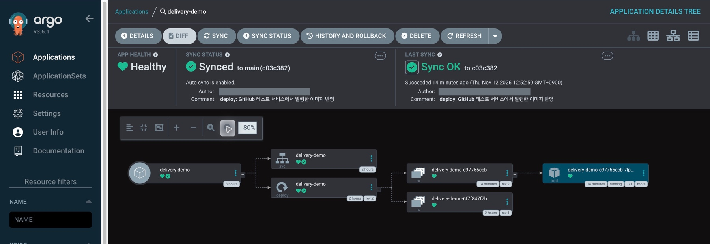

# Delivery Pipeline

[](https://github.com/hskhsmm/delivery-pipeline/actions/workflows/ci.yml)

**Gradle 서비스가 설정 파일 하나로 공통 Jenkins 빌드와 Docker Hub 이미지 발행을 재사용하는 Shared Library입니다.**

서비스마다 Jenkinsfile에 빌드 명령, 환경변수 처리, 레지스트리 인증을 반복해서 작성하면 같은 정책을 바꿀 때 여러 저장소를 고쳐야 합니다. 이 프로젝트는 공통 절차를 Groovy 라이브러리에 두고, 서비스는 짧은 `Jenkinsfile`과 `jenkins.yml`로 필요한 값만 전달하도록 구성했습니다. 발행이 성공하면 소스 커밋과 정확한 이미지 참조를 한 파일에 남겨 다음 배포 단계에 전달합니다.

## 현재 어디까지 되었나요?

**GitHub의 Java 서비스 커밋을 Jenkins가 직접 받아 Docker Hub에 발행하고, Argo CD가 새 이미지로 로컬 Kubernetes의 배포를 갱신하는 것까지 검증했습니다.** Jenkins가 남긴 `published-image.json`의 이미지 digest를 로컬 GitOps 저장소에 직접 커밋했습니다. 검증 환경은 `linux/arm64`입니다.

| 확인한 범위 | 검증 방법과 결과 |
| --- | --- |
| 공유 라이브러리 | Gradle 빌드와 테스트 42개 통과. YAML 검증, 단계 순서, 실패 시 발행 중단, 임시 인증 파일 정리 확인. [GitHub Actions](https://github.com/hskhsmm/delivery-pipeline/actions/runs/43142730524) |
| 실제 Jenkins | 비공개 Java 서비스 커밋 `01c4f84`과 공개 공유 라이브러리 커밋 `6a3367c`를 GitHub에서 직접 체크아웃. `Checkout → Configure → Verify → Publish Image` 성공 및 `published-image.json` 보관. |
| 원격 이미지 | Jenkins가 서비스 커밋 SHA로 태그를 만들고, 발행한 이미지의 digest와 `sourceRevision`을 아티팩트에 기록. 공개 이미지 저장소에서 digest로 내려받을 수 있습니다. [Docker Hub 이미지 저장소](https://hub.docker.com/repository/docker/smini/delivery-pipeline-demo) |
| 로컬 GitOps 재배포 | 전용 kind 클러스터 `delivery-sandbox`에서 Argo CD가 새 digest를 담은 로컬 GitOps 커밋 `c03c382`로 동기화. `Synced`·`Healthy`, 새 Pod의 이미지 pull 이벤트, Service의 `/health` 응답 `200 OK` 확인. |



*Argo CD에서 GitOps 커밋 `c03c382`의 동기화 성공과 새 Pod의 실행 상태를 확인했습니다. 커밋 작성자 정보는 가렸습니다.*

### 발행된 데모 실행

이미지 태그 대신 **digest**로 실행하면 Jenkins에서 확인한 것과 같은 이미지를 받을 수 있습니다. 아래 이미지는 ARM64 환경에서 검증했습니다.

```sh
docker run --rm -p 127.0.0.1:18080:8080 \
  docker.io/smini/delivery-pipeline-demo@sha256:33eef84e8c41ac26054eee2dd22b9e80abc940ed5528ee73317b113903b90d5e
```

다른 터미널에서 `curl -i http://127.0.0.1:18080/health`를 실행하면 `200 OK`와 `ok`가 표시됩니다. 공개 이미지는 로컬 발행 검증용 경량 Dockerfile로 만들었습니다. 같은 Dockerfile을 별도 Java 테스트 서비스 저장소에 담았고, 이 라이브러리 저장소의 [기본 예제](examples/gradle/Dockerfile)는 일반 JRE 이미지로 시작합니다.

## 어떻게 설계했나요?

```text
서비스 저장소 ── Jenkinsfile + jenkins.yml
    ↓
deploy() ── Checkout → Configure → Verify → Publish Image (선택)
    ↓
Docker Hub 이미지 + published-image.json (이미지 digest와 소스 커밋)
    ↓ digest를 직접 커밋
로컬 GitOps 저장소 → Argo CD 동기화 → Kubernetes Deployment / Service
```

| 설계 결정 | 코드에서 적용한 방식 |
| --- | --- |
| 서비스 설정과 공통 정책 분리 | [deploy()](vars/deploy.groovy)가 에이전트를 할당한 뒤 한 번만 체크아웃합니다. 같은 작업 공간에서 [YAML 설정](vars/deploy.groovy)을 읽고 필수값, 타입, 지원하지 않는 키를 검사합니다. |
| 실패 지점과 실행 범위 명확화 | 체크아웃·설정 읽기와 빌드에 각각 제한 시간을 둡니다. [Gradle Verify](vars/deploy.groovy)는 `buildEnv`를 빌드 명령에만 적용합니다. Verify에서 실패하면 발행 단계에 진입하지 않습니다. |
| 자격 증명 사용 범위 제한 | [이미지 발행 단계](vars/deploy.groovy)가 Jenkins 자격 증명을 발행 셸에만 연결합니다. [발행 스크립트](resources/dev/delivery/publish-image.sh)는 빌드 컨텍스트 밖에 임시 Docker 설정을 만들고 종료 시 삭제합니다. |
| 소스와 배포할 이미지 연결 | 소스 커밋 SHA를 이미지 태그에 넣고, Buildx가 반환한 digest를 검증한 뒤 `published-image.json`에 이미지 참조와 소스 커밋을 기록합니다. |

처음에는 설정 검증과 단계 순서를 테스트 하네스로 확인했습니다. 실제 Jenkins로 옮기자 설정 객체 생성에서 Groovy CPS 실행 방식과 샌드박스의 제약이 드러났습니다. 검증을 팩터리 메서드로 옮기고 생성자에는 필드 대입만 남겼으며, 직접 생성하던 컬렉션을 Groovy 리터럴로 바꿔 샌드박스 승인 추가 없이 실행했습니다. [CPS 수정](https://github.com/hskhsmm/delivery-pipeline/commit/a7f9d3f) · [샌드박스 수정](https://github.com/hskhsmm/delivery-pipeline/commit/05e6d08) · [Jenkins CPS 레퍼런스](https://www.jenkins.io/doc/book/pipeline/cps-method-mismatches/)

실제 발행에서는 인증 후 레이어 업로드 중 연결이 끊겼습니다. 로컬 샘플에서 `jlink`로 필요한 Java 모듈만 포함하고 런타임을 여러 레이어로 나눈 뒤, 같은 라이브러리로 발행과 pull을 완료했습니다. 이 검증에서 공용 라이브러리의 발행 로직은 그대로 사용했습니다.

## 내 서비스에서 사용하기

1. Jenkins에 이 저장소를 `delivery-pipeline`이라는 Shared Library로 등록합니다. Jenkins에는 **Pipeline Utility Steps**가, 에이전트에는 서비스에 맞는 JDK와 POSIX 셸이 필요합니다. [Jenkins 등록 가이드](docs/getting-started.md)
2. 서비스 저장소 루트에 실행 가능한 Gradle Wrapper와 아래 두 파일을 둡니다. Jenkins 잡은 **Pipeline from SCM** 또는 **Multibranch Pipeline**으로 서비스 저장소를 연결합니다.
3. Docker Hub 발행도 하려면 에이전트에 Docker Engine·CLI·Buildx를 준비하고, Jenkins Credentials에 Docker Hub 사용자명과 쓰기 권한 토큰을 **Username with password**로 등록합니다. **Credentials Binding** 플러그인이 이 자격 증명을 발행 단계에 연결합니다. 서비스의 루트 `Dockerfile`과 아래 `image` 설정을 사용합니다. [이미지 발행 가이드](docs/image-publishing.md)

**Jenkinsfile**

```groovy
@Library('delivery-pipeline@main') _

deploy()
```

**jenkins.yml**

```yaml
serviceName: orders-api
timeoutMinutes: 30
image:
  repository: your-namespace/orders-api
  credentialsId: dockerhub-publisher
```

`image` 블록을 생략하면 Gradle 검증까지만 실행합니다. 에이전트 기본 라벨은 `java`이며 필요하면 Jenkinsfile에서 `deploy(agentLabel: 'java21-docker')`로 지정합니다. 팀에서 계속 사용할 때는 `@main` 대신 검증한 커밋 SHA나 릴리스 태그를 고정할 수 있습니다. [설정과 API 레퍼런스](docs/reference.md)

## 로컬 개발과 코드 구조

JDK 21과 저장소에 포함된 Gradle Wrapper를 사용합니다. 아래 명령은 라이브러리의 Groovy 컴파일과 테스트를 실행하며, GitHub Actions도 같은 명령을 실행합니다.

```sh
./gradlew --no-daemon build
```

| 위치 | 역할 |
| --- | --- |
| [`vars/deploy.groovy`](vars/deploy.groovy) | `deploy()` 진입점, 설정 검증, Gradle 빌드, 이미지 발행 |
| [`vars/servicePipeline.groovy`](vars/servicePipeline.groovy) | 기존 Map 호출을 공통 구현으로 전달 |
| [`resources/dev/delivery/`](resources/dev/delivery/) | Docker Buildx 발행 스크립트 |
| [`test/`](test/) | Jenkins 스텝 하네스, 실제 YAML 파싱, 발행 실패 및 인증 파일 정리 테스트 |
| [`examples/gradle/`](examples/gradle/) | Java 샘플, Jenkinsfile, 서비스 YAML, Dockerfile |

[아키텍처와 설계 결정](docs/architecture.md) · [기여와 커밋 규칙](CONTRIBUTING.md)

## 다음 단계

1. **원격 GitOps 저장소 연결.** Argo CD의 소스를 원격 GitOps 저장소로 옮기고, 그 저장소의 변경이 클러스터에 반영되는지 확인합니다.
2. **digest 변경 PR 자동화.** Jenkins가 발행에 성공하면 `published-image.json`의 digest로 배포 설정 변경 PR을 엽니다. PR이 병합되면 Argo CD가 추적하는 Git 브랜치의 변경을 반영합니다.
3. **재사용 범위 검증.** 별도 Kotlin Gradle 서비스에서도 같은 진입점으로 발행하고, `amd64` 환경이 필요해지면 해당 플랫폼용 이미지 빌드와 실행을 검증합니다. 환경별 차이가 생기면 Kustomize로 공통 YAML과 환경별 설정을 분리하는 방식을 검토합니다.

[상세 로드맵](docs/roadmap.md) · [Argo CD의 CI 연동 방식](https://argo-cd.readthedocs.io/en/stable/user-guide/ci_automation/)
